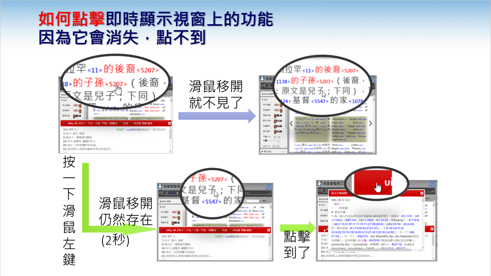

# 信望愛聖經工具 使用說明

線上版：<https://bible.fhl.net/NUI/>

這份說明依「想做什麼」來寫，不是照選單逐項介紹。每一節都可以單獨看，先找你有興趣的就好。

---

## 畫面長什麼樣子

畫面分成工具列和下面三欄：

- **工具列** (最上面一列)：左上角 **≡** 開關左側面板、右上角 **▥** 開關右側面板；中間「創世記：第三章 ▼」選書卷章；右邊是搜尋框，以及 **▦ 信望愛資源** (信望愛網站的其他資源，見下方「找信望愛網站的其他資源」)、**?** 說明、全螢幕、**✉** 問題回報
- 畫面窄 (手機) 時，▦、?、全螢幕、問題回報、版本號都收進 **⋮**，搜尋框收成 🔍，按了才展開
- **左側面板**：選譯本、設定、歷史記錄
- **中間**：經文。點某一節，那一節就成為「目前節」(底色會變)，右側面板的原文、串珠等跟著換成這一節
- **右側面板**：各種研讀資料，點上方的分頁切換。分頁放不下時 (字型大、面板窄)，最右邊會出現 **⋯**，點開就是被收起來的分頁
- 右側面板可以拖拉左邊框調整寬度 (左側面板拖右邊框)；平板上灰框旁邊一點點也按得到

---

## 讀經

### 換書卷、章

- 點工具列中間的 **「創世記：第三章 ▼」** 選書卷和章
- 譯本名那一列最左的 **❮** 是上一章，最右依序是 **❯** 下一章、**←** 向前、**→** 向後 (手機、電腦相同；譯本很多時最後一個譯本名可能被遮住，但欄位仍對齊)
- 在搜尋框直接打 `羅8:28` 也可以跳過去 (見下方〈查經文位置〉)

### 回到剛才讀的地方

左側 **歷史記錄** 會記下你讀過的位置 (記到「節」)。點一下就回去，而且會停在當時那一節，不用再往下捲。

歷史最多留 24 筆，一直查別的就會被擠掉。想留住的，滑過那一筆，按右邊的 📌 **釘住**：釘住的排在最上面，不會被擠掉，按「清除記錄」也會保留；釘住的之間仍照瀏覽順序，剛看過的那章會排到釘住群的最前面。釘的是「整章」，例如釘了雅5:1，之後在雅5 內看到第 2 節，仍是同一個釘，節會跟著更新。再按一次 📌 拔掉。

瀏覽器的「上一頁」也有效。

### 分享目前的經文

網址會跟著你讀的位置變，例如 `https://bible.fhl.net/NUI/#/bible/約3:16`。直接複製網址給別人，對方打開就是同一節。

---

## 多譯本對照

### 選譯本

點左側 **聖經譯本選擇** (或經文上方的譯本名稱)，可以勾選多個譯本同時顯示，例如和合本 + 新譯本 + KJV + 新約原文。

對話框上方有三列：**選取** (目前顯示的)、**常用** (剛取消選取的譯本)、**Sets** (用過的組合)。常用與 Sets 各最多留 10 個，滿了舊的會被擠掉。想一直留著的，按晶片後面的 **📌** 釘住：釘住的排在最前面、不會被擠掉、按「常用」「Sets」清除也不會清掉；再按一次 📌 就拔掉。釘住的設定存在這台電腦的瀏覽器。

### 顯示方式

在 **設定 → 顯示切換** 選：

| 選項 | 適合 |
|------|------|
| 併排（單節） | 每節一列，各譯本左右並排，逐節比較最清楚 |
| 交錯（單節） | 每節底下依序列出各譯本，畫面窄 (手機) 時好讀；每節的各譯本輪完後有一條虛線，與下一節分開 |
| 併排（段落） | 依段落分組並排，讀起來像一般聖經，比較不零碎 |
| 交錯（段落） | 依段落分組，譯本上下交錯 |

段落是以新譯本的分段為準。

### 調整各譯本的欄寬

並排時，各欄寬度預設依各譯本的文字量自動調整 (字多的欄寬一點，各欄差不多一樣高)。想自己調，拖譯本名稱之間的分隔線；雙擊分隔線回到自動 (平板沒辦法連擊，改為長按分隔線不動約半秒)。同一組譯本會記住，經文區、交互參照小視窗、搜尋結果共用同一份設定。分隔線中間有一個小方塊，比較好抓。

最左邊的「出處欄」(例 約3:16) 也能調：拖表頭最左格右邊的分隔線，雙擊 (平板長按) 回預設。搜尋結果與交互參照小視窗共用同一個寬度。

搜尋結果最左邊的「經文出處」欄也能拖：拖表頭最左格的右邊緣調寬，雙擊回預設 (只選一個譯本也可以)。原文解析上下之間的灰框、左右側面板的灰框也是拖中間的小方塊調整，原文解析的灰框雙擊 (平板長按) 回預設高度。

### 複製成對照表 (貼到 Word、PowerPoint、Excel)

反白經文後，會出現藍色的複製按鈕 (電腦在反白旁邊，平板在畫面下方)：

- 按鈕依反白的範圍而不同：
  - 只在一格裡反白：**文字 | 含出處 | 繼續選**。含出處複製帶節碼的經文並接上出處，沒選到的頭尾以 `...` 表示，例：選「免得受審判。」→ `9 ... 免得受審判。 ...(雅5:9_和合本)`
  - 跨節 (同一譯本，沒跨譯本)：**文字 | 連續 | 含出處 | 繼續選** (上排) 與 **表格 | MD | ASCII | ⚙** (下排)。文字每節一行；連續各節接成一段、不換行；含出處再於結尾加 `(詩107:1-3_和合本)`；表格貼上是 table
  - 跨譯本：**含出處 | 繼續選** (上排) 與 **表格 | MD | ASCII | ⚙** (下排)。含出處每個譯本一行，各自帶出處
- **只在一格裡反白**：複製反白的那段文字 (跟一般複製一樣)
- **跨過格子** (跨譯本或跨節)：以「整格」為單位，選到的格子會整格上底色，複製出來是表格 (含譯本名稱、節碼)；貼到只吃純文字的地方則是用 tab 分隔
- 並排時從一格拉到另一格，就是以這兩格為對角的長方形
- 平板：拖水滴跨過格子後放開，約 1 秒後藍色反白會收起來，只留整格底色。之後可以
  - 拖長方形左上、右下的 **圓點** 改範圍；拖到經文區上下邊緣會自動捲動，越靠邊捲越快，可以選超過一個畫面
  - **長按另一格**：範圍改成從起點格到那一格
  - **點一下空白處** 取消
- **繼續選** (電腦、平板都有)：反白一段後，按「繼續選」，再選另一段 (可以在同一格、別的節、別的譯本)，不連續的幾段一次複製。電腦也可以按著 **Ctrl** (Mac 用 ⌘) 再拖曳，不必按按鈕；Ctrl 不放開，一段一段選下去，按鈕都不會跳出來，全部選完放開 Ctrl 才出現
  - 按下「繼續選」或 Ctrl 時，按鈕先收起來 (免得擋住要選的字)；新的一段選好 (電腦放開滑鼠、平板長按另一處) 才在最下面那一段旁邊再出現。平板長按另一處後可以拖水滴調整，前面選好的不受影響
  - 前面選好的片段會留著底色；兩段接在一起或重疊會自動併成一段
  - 輸出每一節都有節碼，沒選到的頭尾、段與段之間以 `...` 表示，例：選「長了銹；」與「收割莊稼，」→ `3 ... 長了銹； ... 4 ... 收割莊稼， ...(雅5:3-4_和合本)`；節不連續時出處是 `雅5:1,3-4`
  - 單次選取跨格 (原本的行為) 仍是整格；用「繼續選」加選的片段不展開，只複製你選的字
  - Esc 取消；平板在按鈕以外的空白處輕點也可取消
- Ctrl+C (或選單的複製) 跨格時也是複製對照表
- 搜尋結果、交互參照小視窗也能這樣複製，會多一欄經文位置
- **MD**：複製成 Markdown 表格 (純文字，不含顏色)，適合貼到 .md 筆記、VS Code、聊天軟體
  - 並排：表頭是譯本名稱；某譯本把兩節譯成一節時，被併掉的那格寫「（併入上節）」
  - 交錯：多一欄「譯本」，一列一個譯本的一節 (或一段)
- **ASCII**：複製成純文字畫框的表格 (`+---+`、`| |`)，格內太長會自動換行，中文用全形空白補齊；適合貼到純文字信件、聊天、程式碼註解，用等寬字型看才對齊
- **表格** 貼到 Word、PowerPoint、Keynote 都有框線 (每一格都有)，譯本名稱那一列水平、垂直置中。貼到 Pages 若有格子的字被切掉，選取各列 → 按列編號右側的箭頭 →「符合內容的高度」
- **⚙**：表格要帶哪些樣式。預設只有字色與框線；背景色、字型、字級、依目前主題 (深色主題也複製深色的顏色) 預設不勾；「表頭用 th」不勾則表頭改成粗體 (Keynote 的標題列比較矮)。貼到 Pages 若出現灰底，是 Pages 的「交換列顏色」，到表格格式取消勾選即可

---

## 原文：不懂希臘文、希伯來文也能用

### 什麼是 Strong Number (SN)

每個希臘文、希伯來文的字都有一個編號，例如「愛」(agapē) 是 G26。和合本、KJV 這類譯本在每個中文詞後面標上它對應的原文編號，所以即使不懂原文，也能知道「這裡的『愛』和那裡的『愛』是不是同一個原文字」。G 是希臘文 (新約)，H 是希伯來文 (舊約)。

### 顯示 SN

「SN 篩選顯示」對話框標題列的 **?** 有簡短說明 (什麼是 SN、什麼時候用、怎麼用)。

**設定 → SN** (按鈕亮藍) 打開後，和合本、KJV、原文譯本會在字詞旁顯示 SN。

新約原文、舊約馬索拉原文的每個字都對應到 SN，就算不打開原文SN，滑鼠移到原文字上，也會和並排的和合本中同一個原文字一起標出來 (見下方「這個字在本章還出現在哪」)。

新約原文有些地方抄本不一致，會並列兩種讀法：**(韋：…)** 是 Westcott-Hort 版 (黃底)，**(聯：…)** 是聯合聖經公會 UBS 版 (粉紅底)，一段異文一個標籤，某一版沒有這段就不顯示那一邊。文中的 **( )** 是 WH 編者加的 (原版印成 [ ])，表示編者認為這幾個字可疑，不是抄本上原有的符號；**(( ))** 表示編者認為很可能不是原文但仍保留，例如 路22:43-44、約7:53 起行淫時被拿的婦人那段。

七十士譯本 (舊約的希臘文譯本) 大部分的字也有 SN，顯示成 `<G2532>` 這樣帶 G 的，提醒它是希臘文編號，和並排和合本舊約的希伯來文編號 (H) 是不同的字典。它的 SN 是用新約同一個字形推出來的，新約沒出現過的字 (許多人名地名、動物名) 沒有 SN。

### 只顯示某些 SN (SN 篩選)

SN 全部打開，經文會很雜。按 **設定 → ⚙** (SN 旁的齒輪)，選一個 **讀經組合** 就好：

- 連接詞、主要動詞、分詞與不定詞、命令與意願、敘事主線 (舊約)、完成時態 (新約)、神的名號、本章主導詞、實詞
- 每個組合旁的 **?** 說明這樣看可以看出什麼，並附經文例子；點例子會跳過去並套用
- 在齒輪 ⚙ 上按右鍵 (手機長按)，不開對話框就能切換組合
- 自己調好的設定可以「存成我的組合」

想自己調，切到對話框的 **細項** 分頁 (上方的分頁：組合 / 細項；上次停在哪一頁，下次就回到哪一頁)，勾選想看的詞類、或填入想看的 SN，其它的 SN 就會隱藏 (或選「變淡」)。例：

- 只看「因為」γάρ：另外加 `G1063`
- 看段落怎麼連接：勾「連接詞」(δέ γάρ οὖν ἀλλά ἵνα ὅτι…，含沒翻出來的)
- 只看實詞：勾「實詞」(名詞、動詞、形容詞)，冠詞、代名詞、介系詞就不顯示
- 看神的名字：勾「神的名字」
- **本章主導詞**：在右側工具列「排序」分頁最上面選「前 5 名」(依本章特色)，只顯示這章特別常出現的名詞、動詞、形容詞 (例 約15 的常在、果子、恨)，長章短章數量差不多；也可選「≥ N 次」或改「依次數」
- **本章特色是什麼**：在右側工具列「排序」分頁，「本章特色」旁的 **?** 有說明和約翰福音 15 章的實例 (視窗幾乎滿版；「詳細算法」預設收起來，要看再點開)
- **本章排行**：右側工具列的 **排序** 分頁 (在原文與註釋之間) 列出這一章的實詞名次 (字、次數、全約次數)。列的顏色是目前設定：藍 = 依規則顯示 (例：前 3 名)、紅 = 另外加、灰 = 不顯示 (刪除線 = 排除)。顯示中的按 − 排除，沒顯示的按 ＋ 加入 (例：前 3 名但排除第 1 個、再加第 4 個)；點一列在經文中標出，再點跳到下一個位置
- 太常見的字 (例 G846 他、G1510 是) 可以填在「排除」

**動詞形態**：依每個字在經文中實際的形態，而不是字典形：

- 新約：語氣 (限定動詞、直說、假設、祈願、命令、不定詞、分詞)、時態 (現在、未完成、未來、簡單過去、完成、過去完成)、語態 (主動、中間、被動)
- 舊約：形式 (敘述式、完成式、未完成式、連續式、意志式、祈使式、祈願式、鼓勵式、不定詞、分詞)、詞幹 (Qal、Nif‘al、Pi‘el、Pu‘al、Hif‘il、Hof‘al、Hitpa‘el、其它)
- 同一列勾多個是「任一」，不同列要「都符合」。例：語氣勾「分詞」、時態勾「現在」→ 只顯示現在分詞
- 例：新約勾「限定動詞」看句子的主要動詞；勾「命令」看書信中的勸勉；舊約勾「敘述式」看敘事的主線 (然後…然後…)，其它形式常是背景或插敘

和合本的字是用「同一節、同一個 SN」對到原文，再用和合本附的時態碼 (例 `(5723)`) 確認，大多數是對的；同一節同一個動詞出現好幾次時偶爾會多顯示。原文譯本是逐字的。

新約、舊約分開設定 (七十士譯本用新約的)，因為文法不同。詞類是依原文字典形判斷，少數字兼兩種詞類 (例 H2088 זֶה 是代名詞也是形容詞)。舊約的連接詞 ו 是字首，沒有自己的 SN，所以看不到。

勾選的詞類、動詞形態、主導詞、另外加的 SN，符合任一就顯示；排除的一定不顯示。SN 可以直接貼 `G1063`、`<1063>`；寫了 G、H 的會自動放到對的框。

- **含未譯出的 {<…>}**：和合本用大括號標出「原文有、但沒翻出來」的字 (例如很多 δέ)，勾選就連這些也顯示
- **顯示動詞時態碼 (…)**：`(5656)` 這類時態碼跟著它的動詞，動詞顯示時才顯示
- 在原文字典的標題按 **📌**，可以把這個字加入或移出「另外加」，邊讀邊累積

主經文、交互參照對話框、搜尋結果都套用同一個設定 (搜尋的那個 SN 一定顯示；「原文SN」關閉時，搜尋結果也只顯示搜尋的那些 SN，其它隱藏，複製成文字才不會冒出一堆編號)；註釋裡的 SN 是註釋內容，不受影響。設定存在這台電腦的瀏覽器。

### 字上色 (依詞類、動詞形態)

不想看到一堆編號，又想看出句子的骨架：在 SN 篩選對話框選 **字上色**，經文的字本身會上色，SN 關著也可以用。

- **詞類**：動詞、連接詞、介系詞、否定詞、專有名詞各一種顏色 (動詞、連接詞、介系詞與 Parsing 分頁的顏色一樣)
- **動詞形態**：只有動詞上色。新約依語氣 (直說、假設、命令/祈願、不定詞、分詞)，舊約依形式 (敘述式、完成式、未完成式、連續式、意志式、不定詞、分詞)。例：創1 橘色的敘述式是「神說…就有…」的主線，1:22 紅色是「要生養眾多」的命令
- 分不出是哪一種的 (和合本同一節同一個動詞出現幾次、時態碼也分不出) 是灰色加虛線底線
- 滑鼠停在字上，會顯示 SN、詞類、形態，例「G4100 動詞 現在 主動 分詞」
- 齒輪 ⚙ 按右鍵 (手機長按) 也可以切換上色

和合本、KJV、原文譯本都可以用；搜尋結果目前不上色。

### 查一個字的意思

- **點 SN**：跳出原文字典，有字義、詞類、字源、在聖經中怎麼被翻譯。同時列出浸宣出版社與 CBOL 兩份字典
- **設定 → 即時** 打開後，滑鼠移到 SN 上就會在下方顯示簡短字義，不用點

字典裡常列出許多經文。和「正在讀的那一節」相同的經文會以**黃底**標出，並自動捲到那裡，方便看出這節被歸在哪個字義底下；沒有這一節、但有同一章的其它節時，會以**淡黃底＋虛線**標出。從搜尋結果點 SN 時，以那筆搜尋結果的經文為準。

即時顯示的視窗在滑鼠移開後就會消失，所以想點裡面的東西時，先在字上**按一下左鍵**，視窗會多停留 2 秒，這時就點得到了：

### 這個字在本章還出現在哪

滑鼠移到某個 SN 上：
- 本章**同一個原文字**會標成紅色
- **同源字** (字根相同的字，例如「愛」的名詞和動詞) 標成暗紅色 (新約)

註釋、搜尋結果裡的 SN 也一樣，滑鼠移過去，經文、註釋、搜尋結果中同一個字都會一起標出來。

這很適合看一段經文反覆出現的主題字。

即時視窗右欄「同源字」旁的 **?** 可以看同源字是什麼、每一行怎麼讀。

### 看一節經文的原文分析

點一節經文後，右側選 **原文** 分頁：會列出這節每個原文字的原形、詞性、時態語態等文法分析 (Parsing)。動詞、連接詞、介系詞會上色，因為它們對理解句子結構最重要。

### 看整本聖經怎麼用這個字

在搜尋框打 SN，例如 `G26`，就會列出所有出現這個原文字的經文 (見下一節)。

---

## 搜尋

搜尋框在工具列右邊，打完按 **Enter** 或放大鏡。快速鍵 `Alt + Shift + F` 可以直接把游標移到搜尋框。

### 可以搜什麼

| 打什麼 | 例子 | 結果 |
|--------|------|------|
| 關鍵字 | `弟兄` | 所有含「弟兄」的經文 |
| SN | `G26`、`H430` | 所有用到這個原文字的經文 |
| 多個 SN | `G3114 or G3115`、`G3114, G3115` | 用到其中**任何一個**的經文 (「或」，適合同源字) |
|  | `G3114 G3115`、`G3114 and G3115` | **同一節**兩個都有的經文 (「且」) |
|  | `G3114 not G3115` | 有 G3114、但**沒有** G3115 的經文 (`!` 也可以) |
|  | `G3114-G3120` | 這一段編號，每個都算 (「或」) |
| 經文位置 | `羅1:3-4;約3:16` | 直接列出這幾段經文 |
| 希臘文 | `πνεῦμα` | 新約原文與七十士譯本，連變化形 (πνεύματος 等) 一起找 |
| 希伯來文 | `אלהים` | 舊約原文，可以不打母音；多個詞用空白分開 |

希臘文用一般鍵盤的重音就可以，不必特別挑字元。

多個 SN 可以三個以上：`or` `OR` `,` `;` `|` (全形也可以) 是「或」；空白、`and`、`&` 是「且」；`not`、`!` 放在要排除的 SN 前面。同時用時「且」「不要」先算、「或」最後，例如 `G1 G2 or G3` 是「(G1 且 G2) 或 G3」。沒寫 G / H 的號碼，依正在讀的是舊約或新約；一次最多 60 個 SN (範圍也一個一個算)。結果裡每個搜尋的 SN 都會標出來。

什麼時候用：中文常把意思相近的幾個原文字翻成同一個詞，例如[雅 5:7-11](#/bible/雅5:7) 的「忍耐」其實是 G3114、G3115、G5278、G5281 四個字，用 `G3114 or G3115 or G5278 or G5281` 一次搜，就不會漏。即時 SN 視窗「同源字」旁的「搜尋全部」會自動幫你組好。搜尋框與搜尋視窗旁的 **?** 也有說明。

### 設定要搜哪些書卷 (⚙)

搜尋框與搜尋視窗的 **?** 旁邊有個齒輪 **⚙**，可以設定搜尋的範圍：

- **什麼都不勾**：只搜尋正在讀的這一卷書
- 勾了哪個分類 (福音書、保羅書信…)，就**也**搜尋那些分類
- 勾了大的分類，包在裡面的小分類視同勾選。例如勾「新約」，保羅書信就算勾了 (顯示「含於 新約」)
- **全部勾選 / 全部不勾** 一個按鈕切換。預設全勾，也就是整本聖經 (和以前一樣)
- 搜尋視窗上方會寫目前的範圍 (例如「範圍：雅＋保羅書信」)，滑鼠移到 ⚙ 上也會顯示
- 範圍外還有結果時，搜尋視窗上方會寫「範圍外還有 N 節」，按一下，這次搜尋改成整本聖經 (設定不變)

### 搜尋範圍會自己挑

在上面設定的搜尋範圍內，會依你**正在讀的書卷**決定先顯示哪裡：同一卷 → 同作者或同類 (例如保羅書信、約翰著作) → 同約 → 整本聖經。例如正在讀雅各書時搜「弟兄」，會直接顯示雅各書裡的結果。

- 範圍**只有目前這卷**時：直接選取這一卷 (書卷按鈕只有它，分類按鈕不列)
- 範圍還有勾別的分類時：目前這卷結果夠多 (≥ 10 節) 就選這卷；不夠就由小到大選第一個夠多的分類 (例如其它書信)；都不夠就選「範圍內全部」。分類按鈕只列範圍內的

結果視窗上方有分類與書卷按鈕 (括號內是節數)，點一下就能換範圍，正在讀的書卷會用紅框標出。

### 看搜尋結果

- 點結果中的經文位置 (例如 `太 6:19`)，會浮出 **上下文｜前往**：前往是主畫面跳過去，**搜尋視窗還留著**；上下文是另開一個視窗顯示那一章 (自動捲到並標出那一節)，不離開現在的位置，可以一筆一筆點下去看
- 搜尋視窗可以拖到旁邊，也可以在裡面直接再搜
- 每一筆右邊有複製按鈕，會複製「位置 + 經文」
- 勾 **譯本對照**：每節都列出目前所有譯本，不只找到關鍵字的 (會記住)
- 反白結果可以 **複製對照表** (見「多譯本對照」)
- 用 SN 搜尋時，搜的那個 SN 是紫色；滑鼠移到結果中任一個 SN，同一個字會標成紅色 (主畫面經文也會)

---

## 以經解經：串珠與交互參照

### 串珠

右側 **串珠** 分頁：列出目前這節每個重點詞，在聖經其他地方的相關經文。資料來自 TSK (Treasury of Scripture Knowledge)，一部 1830 年代就出版、主張「以經解經」的串珠專著，不加人的解釋，只列經文。

串珠工具列 (前 / 後 / 標題 旁) 的 **⚙** 可選書卷名用英文、中文縮寫或中文全名。

### 點經文位置

註釋、串珠、字典裡出現的經文位置 (例如 `羅5:8`) 都可以點，點下去會在旁邊浮出一排小按鈕 **預覽｜前往｜?**，選一種看法 (點空白處或按 Esc 收掉)：

- **預覽**：跳出小視窗顯示那段經文 (目前所有譯本，照顯示方式並排或交錯；可勾「只顯示第一個譯本」)，看完關掉，原本讀的地方不動
- **前往**：主畫面直接跳到那段經文

預設每次都會問。常用哪一種，可以在 **設定 → 交互參照方法** 選「一律預覽」或「一律前往」固定下來 (小按鈕的 **?** 也能改)。

預覽小視窗左邊的經文位置 (例如 `羅5:8-10`) 也能點，會浮出 **上下文｜前往**：上下文是另開一個視窗顯示那一章 (自動捲到並標出你點的那幾節)，前往是主畫面跳過去。

預覽的小視窗 (以及搜尋、原文字典的視窗) 大小可以自己調：拖視窗的邊或角即可，沒有大小上限 (最大到整個畫面)。拖完的大小會記住，下次開同一種視窗就是這個大小；字型調大時，預設的寬度也會跟著變寬。

---

## 其他研讀資料 (右側分頁)

原文、註釋、串珠三個分頁的切換方式一樣：內容最前面有一列 **前 後 [書卷背景] 標題**，最後面也有同一列，捲到底不必回到上面就能按「後」看下一節。這一列跟著內容捲動，不佔固定的空間，字型調大時更省。註釋分頁多一個 **書卷背景** 按鈕 (進去後變成 **返回註釋**)。

| 分頁 | 內容 |
|------|------|
| 原文 | 目前這節的原文文法分析 (見上方) |
| 註釋 | 信望愛站的聖經註釋，依段落對應；也有書卷背景 |
| 講道 | 涵蓋這段經文的講道錄音 (蔡茂堂、康來昌牧師)，外觀與操作同有聲分頁：可調速度、點進度條、下載；每位講員可看上一段 / 下一段。播放中切分頁不中斷 |
| 串珠 | TSK 串珠 (見上方) |
| 典藏 | 歷代聖經、信仰著作、聖詩的掃描原件，例如 19 世紀的各地方言聖經 |
| 有聲 | 整章的有聲聖經，可以邊聽邊讀 (見下方) |
| 地圖 | 本章出現的地名標在地圖上 (例如 徒16 的腓立比、特羅亞)，可放大縮小。左上角 ⛶ 按鈕可一鍵回到本章所有地名的範圍 (拖曳或移遠後用)。點地名可連到聖光聖經地理：查這個地名、本章所有地名、或 Google 搜尋聖光站內 (例如 創15 的耶布斯) |
| 樹狀圖 | 以原文 SN 畫出的整章結構圖 (PDF，中英各一份)；只在讀羅馬書時出現這個分頁 |
| AI | 產生給 ChatGPT 等 AI 用的資料 (見下方) |

### 有聲

- 右上角按鈕選朗讀版本，依語言分組：華語、台語、客語、粵語、福州話、原文 (希臘文、希伯來文)、族語 (鄒語、達悟語)。旁邊標示「新舊約 / 新約 / 部分」；目前這卷書沒有錄音的版本顯示成灰色
- 可調速度 (0.75× ~ 2×)。有些章有好幾位朗讀者，會出現「朗讀」可選
- 勾「播完接下一章」會自動接著播，左邊經文也跟著翻頁；反過來，換章讀經時播放器也跟著換章
- 現代台語譯本、現代客語譯本、達悟語有**投影片**：切到「投影片」會播放有經文字幕的影片，可全螢幕
- 播放中切到其它分頁 (例如註釋) 不會中斷，左下角會有迷你播放列，可暫停，點文字回到有聲分頁。講道也一樣；同時只會播一個，播講道時有聲聖經會暫停
- 手機鎖定畫面也能暫停、切上一章 / 下一章

### 典藏

可以依分類 (聖經珍藏、信仰著作、聖詩珍藏…) 和語言篩選，例如在語言欄打「話」會找到台灣話、客家話等。有表格和卡片兩種看法，卡片會顯示簡介，按「看更多」展開時畫面不會跳回最上面。表格在字放大時會自動換行；要看書請按該列的「閱讀」按鈕（整列不可點，方便框選複製表格內容）。表頭右緣的小方塊可以拖曳調整欄寬，雙擊 (平板長按) 回到自動寬度。

---

## 用 AI 研讀原文

右側 **AI** 分頁的按鈕會把目前經文的原文分析或各譯本內容，整理成 AI 容易讀的格式並**複製到剪貼簿**。你再貼到 ChatGPT 等 AI 工具，在前面加上自己的問題，例如：

> 依參考資料，分析句法結構，找出獨立句、關係子句、介系詞短語，並說明每句的功能

- **原文相關**：複製原文資料、結構分析、結構與對話
- **譯本比較相關**：譯本資料、對齊後比較、加入原文分析
- **多節**：可以一次產生好幾節 (旁邊的 🔧 設定節數，或依段落、整章)

每個按鈕旁的 ❓ 有範例問法。

---

## 找信望愛網站的其他資源 (▦)

工具列的 **▦** (窄的時候在 ⋮ 裡的「信望愛資源」) 列出信望愛網站上 85 個資源，分成讀經、教學、原文學習、查詢、工具、AI、專欄、連結、義工九組，例如：

- **讀經**：一年讀經進度表、四福音合參 (四本福音書同一件事並排)、經課集、次經、使徒教父
- **原文學習**：金京來博士的原文解經與希伯來文、希臘文課程、文法書、原文單字表
- **查詢**：主題查經、找教會、聖詩歌譜、聖經中的動植物與物件
- **AI**：信望愛站的 AI 聖經助手

每個連結下面有一行灰色簡介。不確定是什麼時，按右邊的 **?**，會展開一小段介紹：這是什麼、什麼時候用、怎麼用。點連結名稱會在新分頁開啟那個網站。

有些資源和本工具的功能是同一份資料，介紹裡會說明差別，例如「專卷研經」和右側的註釋分頁是同一份註釋，差別是它一次顯示整卷書。

---

## 設定

左側 **設定** 展開，設定會記在瀏覽器裡，下次打開還在。

| 設定 | 說明 |
|------|------|
| ⚙ SN | **SN** 按鈕亮藍 = 在字詞旁顯示 SN (⚙｜SN｜即時 是合在一起的一組按鈕)；它左邊的齒輪 ⚙ 開設定對話框 (標題列的 ? 說明什麼是 SN)，可設定只顯示某些 SN |
| 即時 | 與 SN 同一列。亮起時，滑鼠移到 SN 上就顯示字典 |
| 地圖、照片 | 同一列。亮起時，經文中的地名顯示地圖資訊、有圖片的地方顯示照片 |
| 繁中｜簡中 | 兩個按鈕 (沒有標題)：繁體 / 簡體；切換後要重新載入才完全生效 |
| 單節｜段落、併排｜交錯 | 「顯示切換」：兩組分段按鈕 (沒有標題，放不下時自動分兩列)，組合成 4 種對照方式 (見〈多譯本對照〉) |
| 字型大小 | 側邊欄這一列沒有標題，是 **⚙ A− A+ 100%** (⚙ 放最前面，左欄很窄時也看得到)。A− A+ 調整體大小 (經文、原文、SN、介面一起，一次 10%)，跟眼力、螢幕有關，設一次就好。介面以 12pt 為基準，經文等跟著比例變；平板、手機的按鈕不會小於 44px 好按。按 ⚙ 開「字型大小」視窗：一鍵切換 **預設** 或 **投影** (經文、原文、SN 都 48pt，給投影用)，也可分別拖曳調整經文、希伯來文、希臘文、SN 的大小 (放開手才重排版)，視窗貼在畫面頂端，不擋住後面的經文；可存成「我的組合」，並有預覽。右鍵 (手機長按) ⚙ 可快速切換 |
| 淺色｜深色／自動｜高對比 | 「主題」，沒有標題，兩列按鈕：**自動** 跟著電腦、手機的淺色 / 深色 (及「增強對比」) 切換；也可固定 **淺色** 或 **深色**，再按 **高對比** 讓文字、線條更清楚 (自動時高對比不能按，跟著系統)。晚上讀經可選深色 |
| 交互參照：… | 點經文位置時：每次詢問／一律預覽／一律前往 (見〈以經解經〉)。下拉選單的選項文字帶名稱，沒有另外的標題 |
| 選章：… | 選書卷章的視窗樣式 (原「切換經文方法」)：依視窗大小／簡易；手機上不好點時可改「簡易」 |
| 註腳：… | 點擊才顯示，或直接載入顯示 |
| TSK顯示模式 | 不在設定裡，在串珠分頁工具列的 ⚙：書卷名用英文、中文縮寫或中文全名 |

---

## 快速鍵

| 按鍵 | 功能 |
|------|------|
| `Alt + Shift + F` | 游標移到搜尋框 |
| `Alt + Shift + Z` | 左側面板開關 |
| `Alt + Shift + C` | 右側面板開關 |
| `Alt + Shift + /` | 開啟這份說明 |

工具列上的 **?** (窄的時候在 ⋮ 裡) 也會開啟這份說明。

---

## 手機

畫面會依寬度調整。手機上建議：

- 用左上 **≡**、右上 **▥** 把左、右面板收起來，專心讀經文；需要時再打開
- 多譯本時用 **交錯** 模式比較好讀

---

## 問題回報

工具列右邊的 **✉** (窄的時候在 ⋮ 裡的「問題回報」) 會開啟 email；也可以填 [回報表單](https://forms.gle/BmuPe2rmKKWgMUr5A)。

工具列左上角版本號旁的 **⟳** (手動更新)，可以在網站更新後強制載入新版；有新版時會顯示「更新至 x.y.z」。點版本號看各版本的變更。窄的時候這兩個在 ⋮ 裡。
